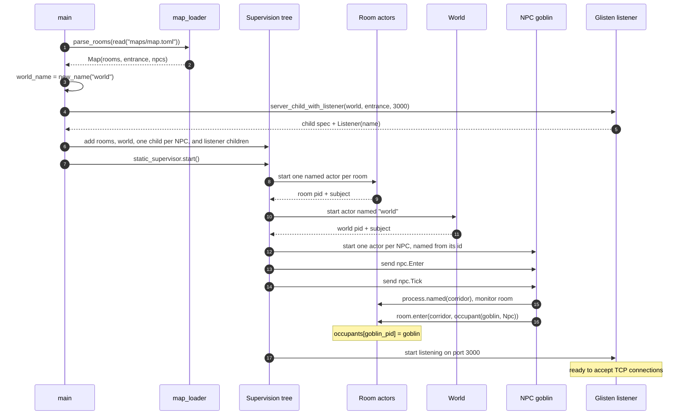
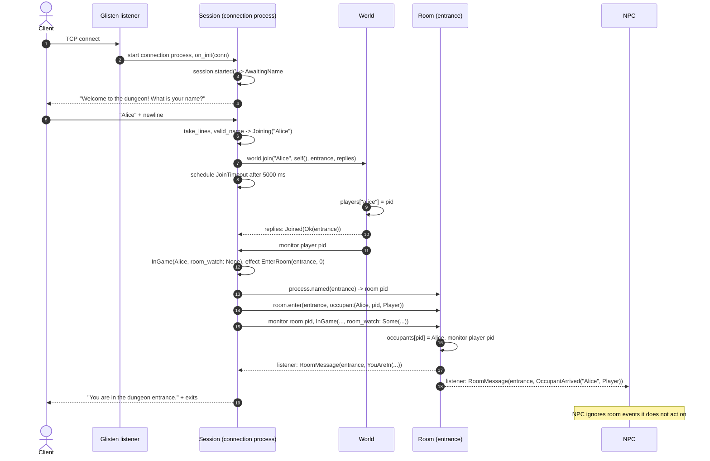
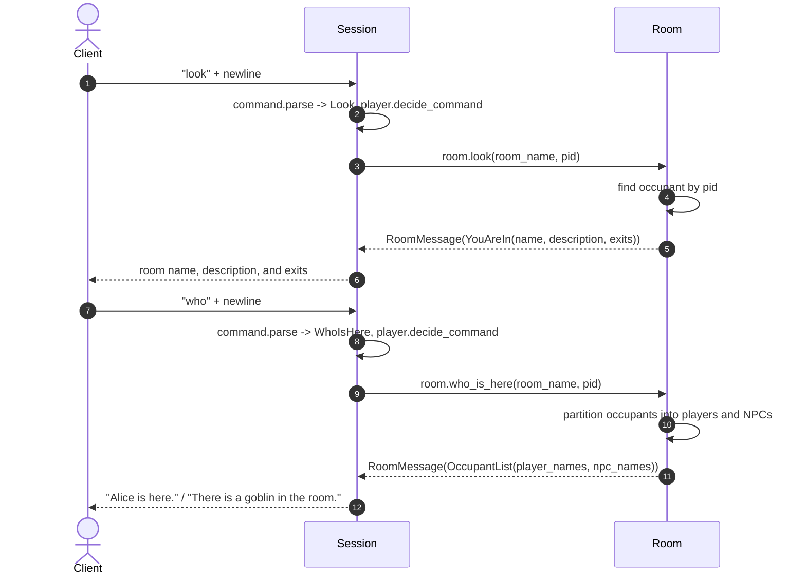
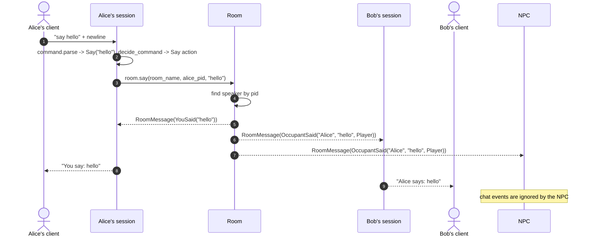
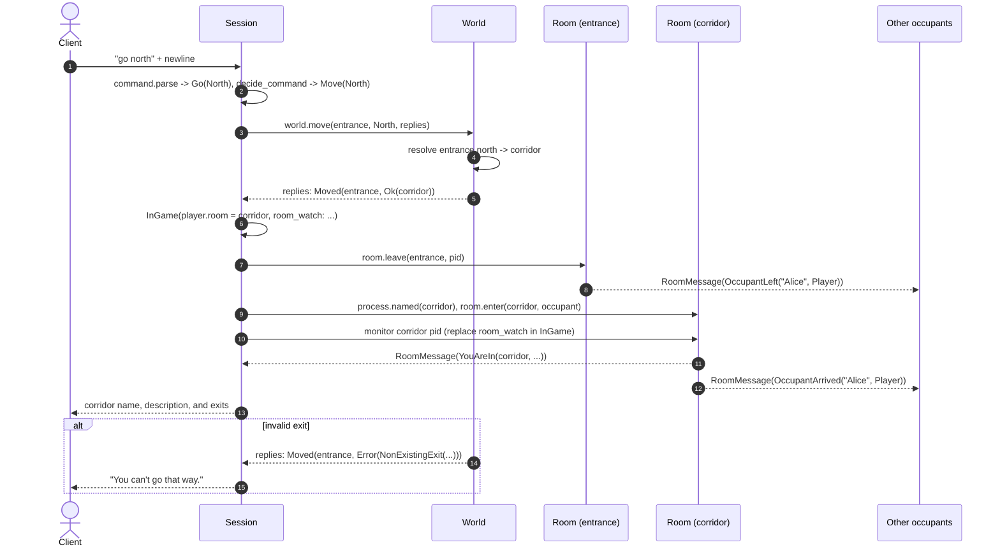
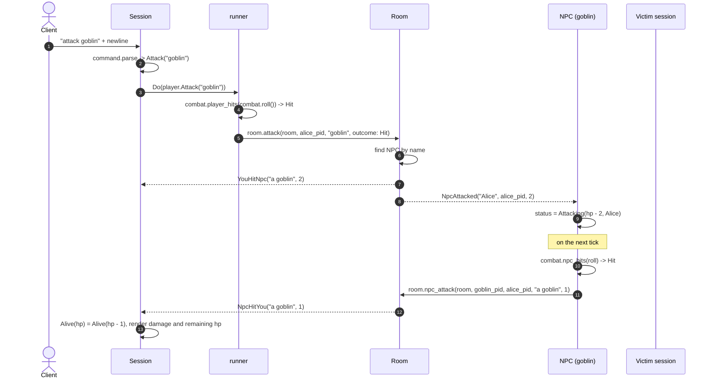
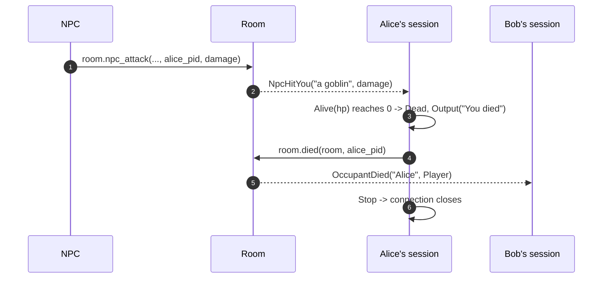
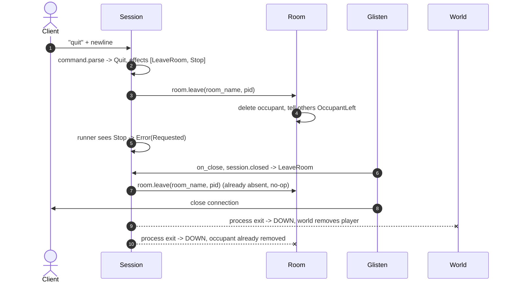
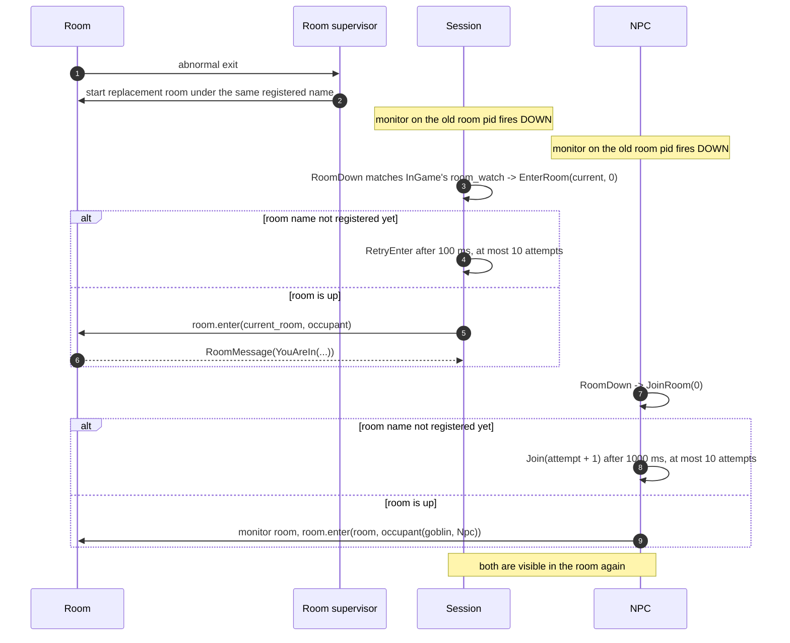

# Multi-user dungeon

I built this project to teach myself the
[Erlang/OTP](https://www.erlang.org/) model for concurrency, using
[Gleam](https://gleam.run/). There are individual processes managing
each player, each room, and each NPC, communicating via messages.

It relies on the [gleam_otp](https://gleam-otp.hexdocs.pm/) and
[gleam/erlang/process](https://gleam-erlang.hexdocs.pm/gleam/erlang/process.html)
libraries for interop with OTP, along with
[glisten](https://glisten.hexdocs.pm/) for handling TCP connections.

## Actors

An actor is simply an Erlang OTP process, i.e. a "green thread". There
is no shared memory, each actor/process has its own state and can only
communicate with other processes through message-passing.

Each actor has:
- a **state**, in the form of a `State` data structure,
- a set of **messages** it can receive (an enum `Message`),
- a set of **actions** it can take (an enum `Action`),
- a pure `decide` function, which transform an existing state and a
  message into an updated state and a list of actions to perform,
- a `run` function, which takes a state and a list of actions and
  execute them (generally by sending messages to other actors).

All of this is threaded into a `handle_message` function, which reacts
to each message by calling `decide` and `run`, and updates the
state. This is the function that is passed to `actor.new()`.

This project has the following actors:
- **world actor:** holding the room graph and the player directory,
- one **room actor** per room: holding that room's occupants,
- one **NPC** actor per NPC,
- a [glisten](https://glisten.hexdocs.pm/) listener that accepts TCP connections.

All under a single [static supervisor](https://gleam-otp.hexdocs.pm/gleam/otp/static_supervisor.html).

A connection is handled by its own process, which owns the `session`
state machine and runs the effects defined in `session`.
`runner.run_effects` turns those effects into sends to the world, the
current room, the socket, or a timer.

## Map file

The world is sepcified in a TOML file, read at startup.

```toml
entrance = "entrance"          # room id where players spawn

[[rooms]]
id = "entrance"
name = "the dungeon entrance"
description = "A wide stone landing at the head of an enormous staircase."
[rooms.exits]
down = "corridor"              # direction = destination room id

[[rooms]]
id = "corridor"
name = "a dimly-lit corridor"
description = "Long and narrow, with a few torches on the walls."
[rooms.exits]
up = "entrance"

[[npcs]]                       # optional, the table may be omitted
id = "goblin"                  # names the process, tags its logs
name = "a goblin"              # what players see and `attack` matches
room = "corridor"              # id of the room it starts in
hp = 3                         # optional starting hp, defaults to 5
```

## Sequence diagrams

### Startup

`main` loads the map, builds the supervision tree, and starts the
listener.  Rooms start first, then the world, then one NPC actor per
`[[npcs]]` entry in the map (each joining its room), and finally the
TCP listener.



### A player connects and claims a name

The connection process starts in `AwaitingName`. A valid name moves it
to `Joining`; the world reserves the name and replies with the
entrance room, and the session then enters that room.



Failure branches handled by the same state machine:

- `Joined(Error(AlreadyLoggedIn))` or `Joined(Error(NoSuchRoom))`
  resets the session to `AwaitingName` and prints the reason (the name
  is case-insensitive).
- No reply within 5 seconds produces `JoinTimeout`: the session
  returns to `AwaitingName` and asks for a name again.
- If the room is not registered yet when entering, the session retries
  every 100 ms, up to 10 attempts, then disconnects.

### Looking around and listing occupants

Both commands are served entirely by the room actor; the session only
renders the event it receives back.



### Talking to the room

A `say` is broadcast by the room. The speaker gets `YouSaid`, everyone
else in the room (players and NPCs) gets `OccupantSaid`. Each session
renders its own event, so messages are queued and delivered
asynchronously.



### Moving between rooms

The world validates the exit and answers with the destination
room. The session then leaves the old room and enters the new one,
which re-registers the player and sends `OccupantLeft` /
`OccupantArrived` to the other occupants.



### Combat

Players start with 100 hp and NPCs with 5. `attack <npc>` sends the
attack through the room, which finds the NPC by name (the leading
article is optional: `attack goblin` finds `a goblin`). The player has
a 85% chance of hitting the NPC. A hit deals 2 damage; a miss still
provokes the NPC, which switches to `Attacking` and targets the
attacker.

While attacking, the NPC rolls its own, lower 30% hit chance on every
tick and deals 1 damage. Damage is routed back through the room, which
is the only process that knows where the target player is. If the
target leaves the room or dies, the room tells the NPC and it returns
to idling.



### Dying

A player at 0 hp is told `You died`, the room broadcasts
`OccupantDied` to the other occupants, and the session stops, which
disconnects the client. The room removes the player when it receives
the death message; the later leave and `DOWN` are harmless no-ops.
NPCs die the same way: the room broadcasts `OccupantDied` and the NPC
actor stops.



### Quitting

`quit` is the one command that produces a `Stop` effect. The session
leaves the room, `runner` reports `Requested`, and the server stops
the glisten connection process. `on_close` runs once more; the extra
leave is harmless, and the world and room monitors also clean up the
pid when the process goes down.



### Recovering from a room crash

The room supervisor restarts a crashed room with an empty occupant
map. Both the players and the NPC monitor their room, so they notice
the `DOWN` and re-enter the replacement. Names may not be registered
yet when the `DOWN` arrives, so both sides retry with bounded backoff.



## Try it

Start a local game server:
```sh
gleam run
```

Then in another terminal, you can use `netcat` to connect:
```sh
nc localhost 3000
```
You can do this several times to have multiple players.

## Tests

```sh
gleam test
```
